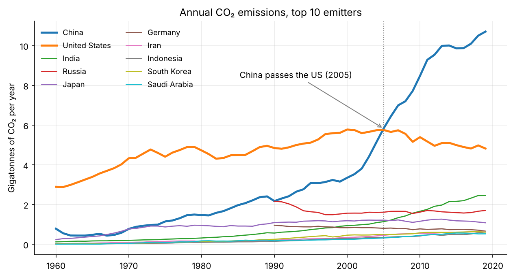
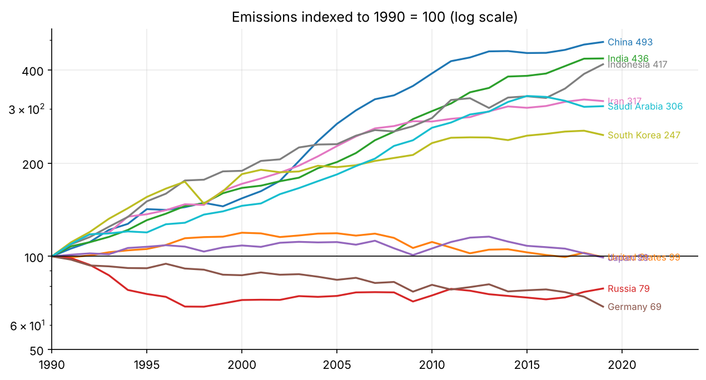
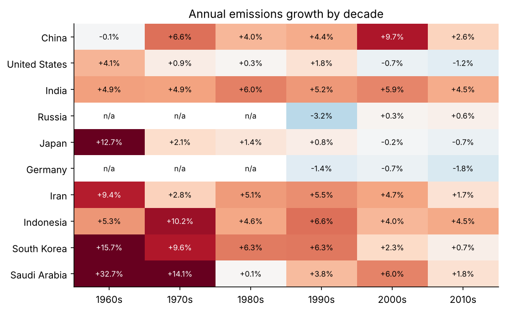

# CO₂ Emissions Trends of the Top 10 Emitters, 1960–2019

How have the world's ten largest emitters (China, the US, India, Russia, Japan, Iran, Germany, Indonesia, South Korea and Saudi Arabia) changed their CO₂ emissions over six decades? This project asks which countries have peaked, who is still growing, and how far each one has moved from the 1990 Kyoto baseline.

**[Open the full notebook →](co2_trends.ipynb)**



## Key findings

- **China passed the US in 2005.** By 2019 it emitted 2.2× as much (10.7 vs 4.8 Gt), 45% of this group's total.
- **Four countries have peaked:** Germany (-31% since 1990), Russia (-21%), the US (-17% since 2000) and Japan (-14% since 2013).
- **Since 1990, the group split in two.** Germany, Russia, Japan and the US are at or below 1990 levels. China (5×), India (4.4×) and Indonesia (4.2×) have multiplied.
- **India is the steady grower,** at about 5% a year in every decade. Japan and South Korea grew 13–16% a year in the 1960s before slowing.
- **The 2010s trend:** rich economies falling about 1% a year; India (+3.6%), Indonesia (+2.8%) and China (+1.8%) still rising.

<p float="left">
  
  
</p>

## A data-cleaning catch

Russia's series drops 44% in a single year, 1989 to 1990. That's because the earlier values are for the whole **Soviet Union**, not the Russian Federation. Treating them as Russian would make Russia look like the biggest emissions cutter in history, so the notebook excludes them and explains why. Germany's series starts at reunification in 1990.

## Methods

- Combined 10 country files into one tidy table and converted kilotons to gigatonnes.
- Peak detection: the year of maximum emissions. A country counts as "peaked" if that year is at least 5 years before 2019 and emissions are at least 5% lower.
- Growth: compound annual growth rate (CAGR) for each decade.
- Recent direction: a linear trend fitted to 2010–2019, scaled by the 2019 level. This describes the past and isn't a forecast.

## Run it

```bash
pip install pandas numpy matplotlib jupyter
jupyter notebook co2_trends.ipynb
```

## Data and credit

Annual CO₂ emissions (kt) from the World Bank, as provided in Emory University's QTM 151 (Introduction to Statistical Computing II) course materials. I first used this data in that course; this analysis is my own work, separate from any course assignment.

*Limitations:* territorial emissions only (not consumption-based), data ends in 2019, and there's no per-person view because the dataset doesn't include population.
